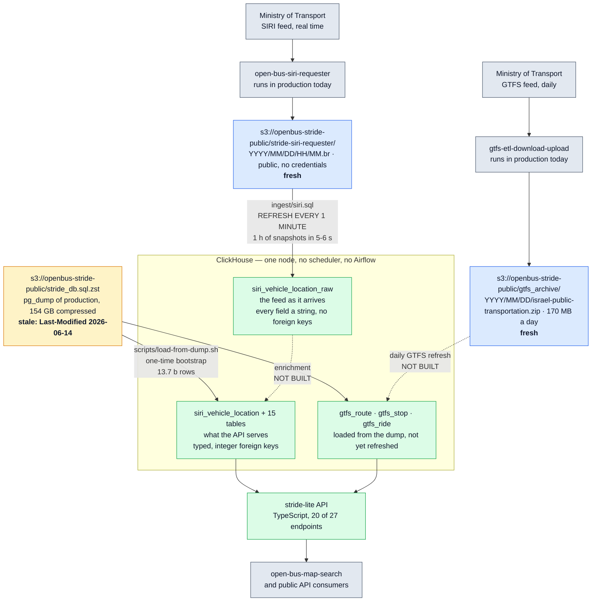

# stride-lite

[English](README.md) · **[עלות, ביצועים, tradeoffs](docs/DEPLOYMENT.md)** · [מפת דרכים](ROADMAP.md) · [מדידות](docs/BENCHMARKS.md) · [הרצה מקומית](docs/LOCAL-DB.md)

מימוש מחדש, מאפס, של ה-backend של
[Open Bus Stride](https://github.com/hasadna/open-bus-stride-api)
על ClickHouse.

אותו חוזה API, בית אחר בית.

חלק קטן מהאחסון.

בלי Airflow.

זה ניסוי, לא הצעה למיזוג.

הוא קיים כדי לענות על שאלה אחת במספרים ולא בדעות:
**איך היה נראה, ומה היה עולה, ה-backend של נתוני התחבורה הציבורית בישראל אם היו בונים אותו היום?**

> 🤖 רוב העבודה בריפו הזה נעשתה על ידי Claude (סוכן AI) בעבודה עם
> [@NoamGaash](https://github.com/NoamGaash).
> כל מספר כאן נמדד בפועל וניתן לשחזור לפי ההוראות ב-[docs/LOCAL-DB.md](docs/LOCAL-DB.md).
> שום דבר כאן לא מצוטט מהזיכרון.

## התחלה מהירה

```bash
curl https://clickhouse.com/ | sh && ./clickhouse server --daemon
export CH_CLIENT="./clickhouse client"
./scripts/apply-schema.sh                                  # 16 טבלאות
CH_DB=stride ./ingest/backfill.sh 2026 11 03               # יום של SIRI חי מ-S3, כ-2 דקות
./clickhouse client --database stride --multiquery < ingest/siri.sql   # ingest רציף, בלי scheduler
cd api && npm ci && CH_DB=stride npm start                 # API על :8080
```

בלי Docker, בלי root, בלי credentials — הנתונים ציבוריים.

השחזור המלא, כולל הדאמפ של 13.7 מיליארד השורות, ב-[docs/LOCAL-DB.md](docs/LOCAL-DB.md).

העלות והמשאבים בענן ב-[docs/DEPLOYMENT.md](docs/DEPLOYMENT.md).

## שלושת המספרים שהניעו את זה

נמדד על גיבוי הפרודקשן הציבורי מ-14/06/2026 — כל 16 הטבלאות, 13,728,053,041 שורות,
טעונות ונספרות בפועל, לא באקסטרפולציה.

| | PostgreSQL היום | ClickHouse |
| --- | --- | --- |
| `siri_vehicle_location` (6.5 מיליארד שורות) | **1.34 TB** | **111.52 GiB** |
| כל מסד הנתונים | כ-692 GiB נתונים גולמיים ועוד כ-760 GB אינדקסים | **163.22 GiB** |
| גדילה בשנה | +307 GB | **+36 GB** |
| חשבון AWS משוער | — | **כ-$96 לחודש** |

שלושה ממצאים שמסבירים אותם:

1. **האינדקסים הם 55% מהנפח של PostgreSQL** — 93 בתים של נתונים מול 107.6 בתים של אינדקס
   לשורה. מסד עמודות לא משלם את זה.
2. **כמעט חצי מהמסד הוא פלט ETL.**

   `siri_ride_stop` (2.80 מיליארד) ו-`gtfs_ride_stop` (4.11 מיליארד) קיימות רק כתוצאות
   שחושבו מראש. ב-ClickHouse רוב הקשרים האלה הם עמודות `ALIAS` בעלות אחסון אפס.
3. **היוקר הוא בתזמור, לא בדאטא.**

   העבודה השוטפת של ה-ETL נמדדת בשנייה אחת לשעה, בעוד ה-scheduler של Airflow לבדו מבקש
   20-25 GB RAM ושתי ליבות. ה-`REFRESH EVERY` של ClickHouse מתזמן את אותה עבודה בתוך המסד
   ומדווח עליה ב-`system.view_refreshes`.

## איפה זה עומד

**22 מתוך 22 מקרי בדיקה דיפרנציאליים על 13 endpoints זהים לפרודקשן בית אחר בית.**

לא "אותו status code" — אותו JSON.

| | |
| --- | --- |
| endpoints שתואמים לפרודקשן | 13 מתוך 27 |
| endpoints רשומים אך לא מאומתים | 7 |
| endpoints שלא נכתבו | 7 (חמישה מהם דורשים SQL אגרגטיבי בכתיבת יד) |
| בדיקות יחידה על בניית ה-SQL | 35, עוברות, בלי מסד נתונים |
| שורות קוד ב-API | 1,105 TypeScript |

תנאי הקבלה הוא 27 מתוך 27.

[ROADMAP.md](ROADMAP.md) מפרט מה נשאר.

### מה החוזה באמת אומר

מימוש מחדש של API הוא בעיקר גילוי מה הוא למעשה מבטיח.

ארבעה דברים שרק הקוד והבדיקות החיות חושפים, וכל אחד מהם שובר לקוח בשקט אם טועים בו:

- **לסדר השורות יש ארבע צורות שונות**, לפי האופן שבו כל handler מכריז על הפרמטר `order_by`
  — לא ברירת מחדל אחת. `/gtfs_stops/list` מתעלם מ-`order_by` לגמרי.
- **שני חוזי datetime נפרדים.**

  פרמטר ברזולוציית יום מקבל תאריך קלנדרי חשוף. פרמטר ברזולוציית רגע **דורש** היסט אזור זמן
  וממיר ל-UTC במקום להשמיט אותו. שליחת תאריך חשוף לשני היא 422; השמטת ההיסט היא 500.
- **דיוק המיקרו-שניות הוא פר עמודה**, לא גלובלי. דיוק בזה, במקום שדרוג גורף, חסך כ-26 GB
  בטבלה הגדולה ביותר.
- `/gtfs_rides/list` לא חוזר בתוך ה-timeout של הפרודקשן על שאילתת טווח תאריכים פשוטה, ולכן
  הצורה הזאת לא יכולה לשמש בסיס להשוואה דיפרנציאלית.

## ארכיטקטורה



**חצים מלאים הם מה שבנוי ונמדד; חצים מקוטעים הם מה שלא נבנה.** תוויות התרשים באנגלית
בכוונה — שמות טבלאות ונתיבי S3 הם ממילא לטינית, ועירוב כיווניות בתוך SVG נשבר.

שלושה מקורות דאטא, וההבדל ביניהם הוא מה שחשוב:

- **הארכיונים של ה-requesters חיים.** ל-`stride-siri-requester/` נכנס snapshot בקירוב כל דקה
  ול-`gtfs_archive/` פיד כל יום, שניהם נכתבים על ידי תהליכים שכבר רצים בפרודקשן, ושניהם
  ציבוריים וניתנים לקריאה עם `NOSIGN`. זה מה שלופ ה-ingest הרציף קורא.
- **הגיבוי של מסד הנתונים אינו חי.** הוא bootstrap חד-פעמי לארבע שנות היסטוריה, והוא הפסיק
  להיכתב ב-14/06/2026.
- לכן הטבלה הגולמית מתעדכנת עד היום, בעוד הטבלאות שה-API משרת נעצרות בדאמפ — כי ה-enrichment
  שהיה מחבר ביניהן הוא החץ החסר.

שלושת הנתיבים נבדקו מול S3 ב-04/11/2026: הדאמפ עדיין מחזיר
`Last-Modified: Sun, 14 Jun 2026`, ב-`gtfs_archive/2026/11/03/` יש את הפיד של אותו יום,
ו-`stride-siri-requester/2026/11/04/` היה כבר בשעה 05.

| שכבה | טכנולוגיה | קוד חדש |
| --- | --- | --- |
| איסוף SIRI | ה-`open-bus-siri-requester` הקיים, ללא שינוי | אין |
| ingest של SIRI → טבלה גולמית | ClickHouse `s3()` ועוד materialized view מתרענן | [`ingest/siri.sql`](ingest/siri.sql) — 3 אובייקטים, בלי scheduler |
| מהגולמי לטבלאות המוקלדות של ה-API | materialized views | **לא נבנה** |
| ingest של GTFS | shell: curl, unzip, `clickhouse-client` | כ-15 שורות |
| העשרה (enrichment) | materialized views של ClickHouse | **אין** |
| תזמון | `REFRESH EVERY` של ClickHouse | **אין** |
| ניטור | `system.view_refreshes` | **אין** |
| API | TypeScript | השירות היחיד |
| תשתית | Terraform | — |

**לופ ה-ingest בנוי ורץ** — וזה בדיוק החלק שה-`PLAN.md` של הסדנה עצמה עוד מסמן כפתוח
("לעקוב אחרי snapshots שנטענו", "לטעון snapshots חדשים כשהם מגיעים", *probably via Airflow*).

זה שלושה אובייקטים בקובץ SQL אחד ובלי Airflow: טבלת `ReplacingMergeTree` של מזהי snapshots,
view אינקרמנטלי שמתחזק אותה מהנתונים עצמם, ושני views מתרעננים שקוראים מ-S3 ומדלגים על מה
שכבר בפנים.

נמדד מול הארכיון החי: **שעה של snapshots נטענת ב-5-6 שניות, והרצה חוזרת על שעה שכבר נטענה
כותבת 0 שורות ב-0 שניות.**

**מה שהוא עוד לא עושה:** הוא מנחית שורות ב-`siri_vehicle_location_raw`, שזה הפיד של משרד
התחבורה כפי שהוא מגיע — כל שדה string, בלי מפתחות זרים.

ה-`siri_vehicle_location` שה-API משרת הוא מוקלד ומחובר במפתחות שלמים, והוא מגיע היום מהדאמפ.
הגזירה של השני מהראשון היא ה-enrichment, והיא **לא נבנתה**.

כלומר לופ ה-ingest אמיתי, והצינור עדיין לא שלם מקצה לקצה.

`system.view_refreshes` מדווח `status`, `next_refresh_time`, `written_rows` ו-`exception` —
בדיוק הנראות שבגללה יש Airflow, בתוך מסד הנתונים.

**TypeScript ב-API בכוונה**, לא לפי טעם: ה-client הנוצר
`@hasadna/open-bus-api-client` וה-[פרונטאנד](https://github.com/hasadna/open-bus-map-search)
כבר כתובים ב-TypeScript, כך שהטיפוסים משותפים מקצה לקצה.

**מה שחסר בכוונה:** dbt, scheduler, תור הודעות, שכבת cache, ORM.

27 endpoints של GET עם סינון וסידור הם בניית שאילתות, לא מודל אובייקטים. כל השמטה מנומקת
ב-[ROADMAP.md](ROADMAP.md).

## מבנה

```
db/schema.sql     16 הטבלאות, כפי שנשלפו מהמסד הרץ
ingest/           siri.sql (רציף, 3 אובייקטים), backfill.sh (היסטוריה)
api/              שירות TypeScript — src/{sql,registry,server,ch}.ts
infra/main.tf     מודול Terraform
scripts/          apply-schema.sh, load-from-dump.sh
docs/             BENCHMARKS.md (הדוח המלא), LOCAL-DB.md
```

אם זה מתקדם לאנשהו, החלקים מתפצלים חזרה לריפויים של הסדנה — `db/` וה-ingest ל-
`open-bus-stride-clickhouse`, `api/` ל-`open-bus-stride-api`, ו-`infra/` ל-`hasadna-iac`.
הגבולות בין התיקיות נשמרים נקיים מהיום הראשון כדי שהפיצול הזה יהיה מכני ולא שכתוב.

## הסתייגויות, בכוונה בגוף ה-README

- **ה-ingest וה-API עוד לא מחוברים.** נתונים חדשים נוחתים בטבלה גולמית; ה-API קורא
  מטבלאות מוקלדות שנטענו מהדאמפ. ה-enrichment שביניהם לא נבנה.
- הגיבוי הציבורי הוא **בן 4.6 חודשים** — `Last-Modified: 2026-06-14`, והנתונים בתוכו
  נגמרים ב-29/05/2026. כל מקרה בדיקה דיפרנציאלי חייב להישאר בתוך החלון הזה, וזו האילוצה
  הגדולה ביותר על העבודה.
- **PostgreSQL מנצח בשאילתה אחת** — סינון צר של `line_ref` יחד עם תיבה גיאוגרפית, 0.017
  שניות מול 0.063-0.090. אינדקסי B-tree על `lon`/`lat` הם הכלי הנכון שם, וסגירת הפער עם
  skip indexes היא עבודה שלא נעשתה.
- הסיכון היחיד שלא כומת בהערכת ה-AWS הוא **egress מעל ה-1 TB החינמי של CloudFront**, וצריך
  נתון תעבורה אמיתי לפני שמישהו נשען על ה-$96. ההערכה עצמה בנויה ממחירון AWS הפומבי; מה
  שהפרויקט משלם היום דווח לנו בפרטי ואינו בריפו הזה.
- **ה-projections אינם בתוך ה-163 GiB.** שניים מהם מביאים את הסך הכל הכשר ל-219 GiB.
- הריפו הזה לא עונה על השאלות שבאמת מכריעות מיגרציה: מי מתחזק, מה קורה בשלוש לפנות בוקר,
  ומה נשבר במעבר בין ספקים. אלה הכרעות של המתחזקים, ומדידות לא מכריעות אותן.

## רישיון

MIT. הנתונים ציבוריים, מתפרסמים על ידי משרד התחבורה ונאספים על ידי
[הסדנה לידע ציבורי](https://www.hasadna.org.il/).
