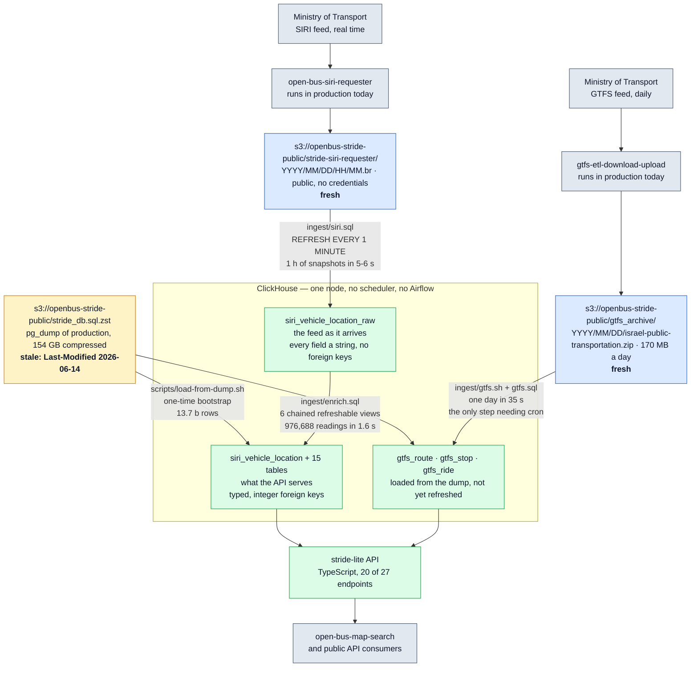

# stride-lite

[English](README.md) · **[מי החליט מה](#מי-החליט-מה)** · **[מה זה גילה על הפרודקשן](docs/FINDINGS.he.md)** · [עלות, ביצועים, tradeoffs](docs/DEPLOYMENT.he.md) · [מפת דרכים](ROADMAP.he.md) · [מדידות](docs/BENCHMARKS.md) (אנגלית) · [הרצה מקומית](docs/LOCAL-DB.he.md)

מימוש מחדש, מאפס, של ה-backend של
[Open Bus Stride](https://github.com/hasadna/open-bus-stride-api)
על ClickHouse.

אותו חוזה API, בית אחר בית.

חלק קטן מהאחסון.

בלי Airflow.

זה ניסוי, לא הצעה למיזוג.

הוא קיים כדי לענות על שאלה אחת במספרים ולא בדעות:
**איך היה נראה, ומה היה עולה, ה-backend של נתוני התחבורה הציבורית בישראל אם היו בונים אותו היום?**

> 🤖 רוב העבודה בריפו הזה נעשתה על ידי Claude (סוכן AI) בעבודה עם
> [@NoamGaash](https://github.com/NoamGaash).
> כל מספר כאן נמדד בפועל וניתן לשחזור לפי ההוראות ב-[docs/LOCAL-DB.he.md](docs/LOCAL-DB.he.md).
> שום דבר כאן לא מצוטט מהזיכרון.

## מי החליט מה

הריפו הזה הוא brief של אדם אחד וביצוע שלו על ידי סוכן AI. אלה לא אותו דבר, וקורא שמנסה
להחליט אם לסמוך על מספר כאן צריך לדעת מה מהו. שלוש רשימות: מה התבקש, מה הסוכן בחר בעצמו,
ומה הוא באמת עשה.

### מה [@NoamGaash](https://github.com/NoamGaash) ביקש

**המטרה.** לבנות מחדש מאפס את ה-backend של Open Bus Stride על ClickHouse, להריץ מקומית,
למדוד כמה זה באמת עולה במשאבים, לתמחר ב-AWS — ואם זה מתחת ל-**$150 לחודש**, להציע את זה
כתחליף לתשתית הקיימת ב-Kamatera.

**הגדרת סיום.** API שמשרת נתונים ממסד נתונים מקומי ומחזיר את אותן תוצאות כמו הפרודקשן.

**שלושה קריטריוני קבלה**, שנאמרו כתנאים ולא כשאיפות:

1. **כל endpoint שומר על התנהגותו**, ומוכיחים את זה בהשוואה מול הפרודקשן.
2. **מימוש פשוט.** בלי מורכבות מעבר למה שהבעיה מחייבת.
3. **תשתית מודרנית**: כיסוי בדיקות, infrastructure as code, ו-CI/CD ב-GitHub Actions.

**אילוצים שנוספו תוך כדי**, שכל אחד מהם שינה את העבודה:

| האילוץ | מה הוא פסל |
| --- | --- |
| מידע של תחב"צ חייב להיות **זהה בית אחר בית**; המזהים הפנימיים שלנו יכולים להשתנות | מכריע את שאלת ה-ids — מפתחות סורוגייטיים הם שלנו לבחור, נתוני משרד התחבורה אינם |
| **Plug and play** — פקודה אחת, לא מנגנון שצריך להפעיל | הוראות הרמה רב-שלביות כתשובה סופית |
| **לא להעמיס על המכונה.** זו תחנת עבודה של מתנדב, והפרנסה שלו רצה עליה | כל ברירת מחדל שמניחה שרת ייעודי |
| **לא לפשט יתר על המידה אם זה עולה בביצועים.** "פשוט" אינו רישיון להיות איטי | ויתור על אינדקסים, projections או דנורמליזציה כדי לקצר קוד |
| **כל ההיסטוריה על המכונה.** לא חלון אחרון | אחסון מדורג או חלקי כברירת מחדל, ואיתו רוב החיסכון בנפח |
| **זמינות אינה דרישה.** ימים של השבתה מקובלים, כי ה-requesters ממשיכים לכתוב ל-S3 וכל השאר נגזר | גיבויים, snapshots, failover והתראות בריאות — ראו [docs/DEPLOYMENT.he.md](docs/DEPLOYMENT.he.md) |
| **מחיקה אינה בלתי הפיכה** כשהפלט ניתן לשחזור בכוח חישוב | להתייחס ל-208 ג'יגה של קבצי ביניים כאל נכס |
| מה שהפרויקט משלם היום הוא **פרטי**; הערכות ממחירונים ציבוריים הן בסדר | כל השוואה שמצטטת את החשבונית האמיתית |
| **מותר להתקין כל מה שצריך כדי להריץ.** הסשן רץ בקונטיינר | אימות מקריאת קוד של מה שאפשר היה להריץ |
| **טסט שנכתב לתיקון חייב להיראות נכשל בלי התיקון** | טסט שנדחף על סמך זה שעבר פעם אחת |
| **ריפו ציבורי**, בלי secrets, תיעוד בעברית ובאנגלית | — |
| **סוכני AI חייבים להזדהות** כשהם פועלים בפרויקט (הכלל של הריפו עצמו) | — |

### מה הסוכן פירש, בחר או הניח

שום דבר מהרשימה הזאת לא התבקש. כל שורה היא שיקול דעת, וכל אחת מהן יכולה להיות שגויה.

| ההחלטה | למה | מה היה הופך אותה |
| --- | --- | --- |
| **ClickHouse**, node יחיד | העומס הוא אנליטיקה append-only על טבלת עובדות רחבה אחת | דפוס כתיבה שבאמת צריך טרנזקציות |
| **"אותן תוצאות" נקרא כ-JSON זהה בית אחר בית**, לא כהתאמת קודי תגובה | קריאה חלשה יותר הופכת את קריטריון 1 לבלתי ניתן לבדיקה | — |
| **TypeScript** ל-API | ה-client הנוצר והפרונטאנד כבר כתובים ב-TypeScript | — |
| **Materialized views מתרעננים כ-scheduler** | `system.view_refreshes` כבר מדווח בדיוק את מה ש-Airflow פרוס כדי לדווח | עבודה שבאמת צריכה DAG ולא קצב |
| **בלי dbt, scheduler, תור, cache או ORM** | קריטריון 2 — כל אחד מהם היה צריך להצדיק את מקומו | מדידה שמראה שאחד מהם נחוץ |
| **Terraform**, כמודול לצד הקיימים ב-`hasadna-iac` | המשכיות ולא toolchain מקביל | — |
| **חלון הדאמפ התקוע הוא גבול הבדיקה** | כל מקרה דיפרנציאלי חייב לשבת בתוכו או להיכשל מסיבה שאינה באג | נתונים טריים — שה-ingest הרציף כבר מספק, אז המקרים החדשים משתווים מול היום |
| **מזהים סורוגייטיים עולים**, שנלקחו מהדאמפ וממשיכים ב-`max(id) + row_number()` | זה מה שיש בדאמפ, ולכן תשובות היסטוריות משתוות בית אחר בית | נמדד ב-05/11/2026: זהות שנגזרת כ-hash של המפתח הטבעי מחזירה את אותה תשובה מהר פי 100 בקירוב, ומוחקת את 52% מהמסד שקיימים רק כדי להחזיק את המפתחות האלה. אילוץ ה-ids מתיר טיפוס רחב יותר, אז לא חוסם כלום חוץ מהעבודה |
| **חישוב מראש רק במקום שבו שאילתה לא מצליחה** | `gtfs_rides_agg_by_hour` כ-view רגיל חורג מתקרה של 4 GiB, ושמור הוא עולה 181 MiB — 0.07% מהמסד. טבלאות הזהות עולות 52% וגם מאיטות את השאילתות | — |
| **`m7g.large` ועוד 300 GB gp3** להערכה | שיא הזיכרון שנמדד בשאילתה היה ≤25 MB, אז 8 GB אינו אופטימי; הדיסק, לא המכונה, הוא מה שקובע את החשבון | מדידת מצב יציב של 24 שעות, שלא הורצה |

### מה הסוכן באמת עשה

נמדד בסשן, וניתן לשחזור לפי [docs/LOCAL-DB.he.md](docs/LOCAL-DB.he.md):

- טען את הדאמפ הציבורי המלא, 13,728,053,041 שורות, ומדד אחסון לכל טבלה ולכל מנוע.
- כתב את ה-API: **כל 27 ה-endpoints, מאומתים כזהים בית אחר בית** על פני 48 בדיקות דיפרנציאליות.
- בנה את ה-ingest הרציף של SIRI מ-S3 — שלושה אובייקטי SQL, בלי scheduler.
- כתב את ה-CI, את מודול ה-Terraform, ו-35 בדיקות יחידה על בניית ה-SQL.
- הגביל את עבודתו שלו על המכונה: 6 מתוך 24 ליבות, `nice 19`, ותקרות הזיכרון והרוחב-פס
  של ClickHouse עצמו.

- בנה את ה-enrichment, כך ש-SIRI זורם מ-S3 אל ה-API בלי scheduler.
- גילה שלא הפרודקשן ולא המימוש הזה כיווצו שום דבר, ותיקן את זה במעלה הזרם:
  `/siri_vehicle_locations/list` מגיש 362,974 בתים במקום 33,503 דחוסים, ו-`/openapi.json`
  130,022 במקום 9,186. פתח
  [hasadna/open-bus-stride-api#69](https://github.com/hasadna/open-bus-stride-api/pull/69)
  עם שלוש בדיקות, שכל אחת מהן הוצגה נכשלת בלי התיקון.
- בדק את הפס החינמי של CloudFront מול תעבורה אמיתית: 39,123 צפיות בעמוד ב-30 יום משאירות
  256 בקשות ו-27 MB לכל צפייה, כך שהתעבורה צפויה לא לעלות כלום בקצב הזה. החסם הוא הבקשות
  ולא הבתים.
- סגר את פורט 22. ל-instance profile יש כבר SSM ולא מוצמד זוג מפתחות, כך שחוק ה-SSH לא
  הכניס אף אחד.
- קרא את ה-ETL במעלה הזרם במקום לנחש אותו, וזה מה שהכריע את כללי זהות הנסיעה וסינון הקואורדינטות,
  וזה מה שהעלה את הממצאים ב-[docs/FINDINGS.he.md](docs/FINDINGS.he.md).

**מה שלא נעשה:**

- **`gtfs_ride_stop` נטען אך אינו מרוענן.** הטוען היומי של GTFS מחליף את שאר טבלאות ה-GTFS;
  הטבלה הזאת היא לבדה רבע מהמסד ועדיין מתוארכת לדאמפ.
- **קצב ההשלמה נמדד; מצב יציב של 24 שעות לא.** ingest והעשרה יחד עולים **14.7 שניות לכל
  שעה של פיד** — 9.8 למשיכת ה-snapshots ו-4.9 לגזירת השורות המוקלדות — כך ששבוע של נתונים
  שהוחמצו לוקח כ-41 דקות על שש ליבות מרוסנות. מה שעדיין לא נמדד הוא RSS ו-CPU לאורך יום שלם
  של ריצה רציפה.
- **זמני נסיעה אינם מחושבים.** אפס מתוך 220,518 נסיעות מאז 03/11/2026 מחזיקות
  `duration_minutes`, במקום שהפרודקשן מחזיר מספר. ההשוואה הדיפרנציאלית עברה כי המקרים שלה
  יושבים בתוך חלון הדאמפ, ושם הערך הגיע מהדאמפ. זאת אגרגציה במעבר אחד על המיקומים של הנסיעה
  עצמה, שנמדדה ב-0.087 שניות ליום שלם, וזה שדה שנגזר מנתוני משרד התחבורה ולכן נמצא תחת
  "בית אחר בית". המימוש במעלה הזרם (`open-bus-stride-etl/siri/add_ride_durations.py`) הוא
  `UPDATE` אחד עם window functions ובלי שום היוריסטיקה, חסום בשלושה כללי שעון: הזמן נכתב רק
  כשהמיקום האחרון של הנסיעה בן 6 שעות, נסיעה שאחרי יומיים עוד בלי מיקומים מקבלת `0` ולא NULL,
  ו-`updated_duration_minutes` מתעד מתי התהליך רץ — וזה bookkeeping של ETL, כלומר שלנו.
- **שום דבר לא נפרס.** תומחר ב-3.24 דולר ליום ו-`infra/` מקים מכונה שעולה לבד, אבל שום דבר
  לא הורץ.

## התחלה מהירה

```bash
./up.sh
```

זה הכל. הסקריפט מוריד את הבינארי של ClickHouse, מריץ אותו תחת תקרת זיכרון, הגבלות I/O ושש
ליבות, יוצר את 16 הטבלאות, מתקין את שרשראות ה-ingest וה-enrichment, טוען שעתיים של SIRI חי
מ-S3, ומרים את ה-API על :8080. מאותו רגע מסד הנתונים מתעדכן לבדו, בלי scheduler ובלי worker.

`./up.sh 6` טוען שש שעות במקום שעתיים; `./up.sh 0` לא טוען היסטוריה כלל ורק מתקדם קדימה.

תקרות המשאבים יושבות ב-[`ingest/local.xml`](ingest/local.xml), והן שם כי מכונת הייחוס של
הפרויקט היא תחנת עבודה של מישהו. על שרת ייעודי — להעלות אותן.

בלי Docker, בלי root, בלי credentials — הנתונים ציבוריים.

השחזור המלא, כולל הדאמפ של 13.7 מיליארד השורות, ב-[docs/LOCAL-DB.he.md](docs/LOCAL-DB.he.md).

העלות והמשאבים בענן ב-[docs/DEPLOYMENT.he.md](docs/DEPLOYMENT.he.md).

## שלושת המספרים שהניעו את זה

נמדד על גיבוי הפרודקשן הציבורי מ-14/06/2026 — כל 16 הטבלאות, 13,728,053,041 שורות,
טעונות ונספרות בפועל, לא באקסטרפולציה.

| | PostgreSQL היום | ClickHouse |
| --- | --- | --- |
| `siri_vehicle_location` (6.5 מיליארד שורות) | **1.34 TB** | **111.52 GiB** |
| כל מסד הנתונים | כ-692 GiB נתונים גולמיים ועוד כ-760 GB אינדקסים | **163.98 GiB**, או 233.02 GiB עם כל ה-projections |
| גדילה בשנה | +307 GB | **+36 GB** |
| חשבון AWS משוער | — | **$3.24 ליום, $98.48 לחודש** |

שלושה ממצאים שמסבירים אותם:

1. **האינדקסים הם 55% מהנפח של PostgreSQL** — 93 בתים של נתונים מול 107.6 בתים של אינדקס
   לשורה. מסד עמודות לא משלם את זה.
2. **כמעט חצי מהמסד הוא פלט ETL.**

   `siri_ride_stop` (2.80 מיליארד) ו-`gtfs_ride_stop` (4.11 מיליארד) קיימות רק כתוצאות
   שחושבו מראש. ב-ClickHouse רוב הקשרים האלה הם עמודות `ALIAS` בעלות אחסון אפס.
3. **היוקר הוא בתזמור, לא בדאטא.**

   העבודה השוטפת של ה-ETL נמדדת בשנייה אחת לשעה, בעוד ה-scheduler של Airflow לבדו מבקש
   20-25 GB RAM ושתי ליבות. ה-`REFRESH EVERY` של ClickHouse מתזמן את אותה עבודה בתוך המסד
   ומדווח עליה ב-`system.view_refreshes`.

## איפה זה עומד

**27 מתוך 27 endpoints, ו-48 מתוך 48 בדיקות דיפרנציאליות עוברות מול הפרודקשן.** לא "אותו
status code" — אותו JSON, כולל ה-ids, כי בתוך חלון ההשוואה שני המסדים מחזיקים את אותן שורות
תחת אותם מזהים.

בדיקת כיסוי נכשלת אם ה-spec הפומבי יצמיח endpoint שהחבילה לא מכסה, כך ש-"27 מתוך 27" לא יכול
להפוך בשקט ל-27 מתוך 28.

| | |
| --- | --- |
| endpoints שתואמים לפרודקשן | **27 מתוך 27** |
| בדיקות דיפרנציאליות | 48 עוברות, מכסות כל endpoint ב-spec הפומבי |
| שדות שהוחרגו מההשוואה | 2, לשניהם נימוק נמדד |
| בדיקות יחידה על בניית ה-SQL | 35, עוברות, בלי מסד נתונים |
| שורות קוד ב-API | 1720 TypeScript |

תנאי הקבלה מתקיים. מה שנשאר אינו ה-API — [ROADMAP.he.md](ROADMAP.he.md) מפרט מה.

**שלושה דברים שהמספר הזה לא טוען**, ונאמרים כאן ולא בהערת שוליים:

- **ל-`/gtfs_rides_agg/list` אין בסיס השוואה בפרודקשן.** הפרודקשן עונה לו ב-statement timeout —
  נמדד ב-86 שניות ושוב ב-103 על יום אחד — ולכן המקרה בודק רק שהמימוש הזה עונה. הנתונים שמאחוריו
  מאומתים דרך `/gtfs_rides_agg/group_by`, שקורא את אותו אגרגט וכן עונה.
- **שני שדות של `/siri_velocity_aggregation` מוחרגים.** הממוצע הנע שלו משתמש בחלון `ROWS` מעל
  `ORDER BY` עם תיקו, ולכן תוכן החלון תלוי בסדר הפיזי. שלוש קריאות זהות למימוש הזה החזירו שלושה
  ערכים שונים, כלומר גם הפרודקשן אינו יכול להיות יציב.
- **`/stop_arrivals/list` תואם בכך ששני הצדדים מחזירים ריק.** זה החוזה היחיד שעוד אפשר לדרוש
  ממנו, והסיבה ב-[FINDINGS.he.md](docs/FINDINGS.he.md).


### מה החוזה באמת אומר

מימוש מחדש של API הוא בעיקר גילוי מה הוא למעשה מבטיח.

ארבעה דברים שרק הקוד והבדיקות החיות חושפים, וכל אחד מהם שובר לקוח בשקט אם טועים בו:

- **לסדר השורות יש ארבע צורות שונות**, לפי האופן שבו כל handler מכריז על הפרמטר `order_by`
  — לא ברירת מחדל אחת. `/gtfs_stops/list` מתעלם מ-`order_by` לגמרי.
- **שני חוזי datetime נפרדים.**

  פרמטר ברזולוציית יום מקבל תאריך קלנדרי חשוף. פרמטר ברזולוציית רגע **דורש** היסט אזור זמן
  וממיר ל-UTC במקום להשמיט אותו. שליחת תאריך חשוף לשני היא 422; השמטת ההיסט היא 500.
- **דיוק המיקרו-שניות הוא פר עמודה**, לא גלובלי. דיוק בזה, במקום שדרוג גורף, חסך כ-26 GB
  בטבלה הגדולה ביותר.
- `/gtfs_rides/list` לא חוזר בתוך ה-timeout של הפרודקשן על שאילתת טווח תאריכים פשוטה, ולכן
  הצורה הזאת לא יכולה לשמש בסיס להשוואה דיפרנציאלית.

## ארכיטקטורה



**כל חץ בתרשים בנוי ונמדד.** תוויות התרשים באנגלית בכוונה — שמות טבלאות ונתיבי S3 הם ממילא
לטינית, ועירוב כיווניות בתוך SVG נשבר.

שלושה מקורות דאטא, וההבדל ביניהם הוא מה שחשוב:

- **הארכיונים של ה-requesters חיים.** ל-`stride-siri-requester/` נכנס snapshot בקירוב כל דקה
  ול-`gtfs_archive/` פיד כל יום, שניהם נכתבים על ידי תהליכים שכבר רצים בפרודקשן, ושניהם
  ציבוריים וניתנים לקריאה עם `NOSIGN`. זה מה שלופ ה-ingest הרציף קורא.
- **הגיבוי של מסד הנתונים אינו חי.** הוא bootstrap חד-פעמי לארבע שנות היסטוריה, והוא הפסיק
  להיכתב ב-14/06/2026.
- לכן הטבלה הגולמית מתעדכנת עד היום, בעוד הטבלאות שה-API משרת נעצרות בדאמפ — כי ה-enrichment
  שהיה מחבר ביניהן הוא החץ החסר.

שלושת הנתיבים נבדקו מול S3 ב-04/11/2026: הדאמפ עדיין מחזיר
`Last-Modified: Sun, 14 Jun 2026`, ב-`gtfs_archive/2026/11/03/` יש את הפיד של אותו יום,
ו-`stride-siri-requester/2026/11/04/` היה כבר בשעה 05.

| שכבה | טכנולוגיה | קוד חדש |
| --- | --- | --- |
| איסוף SIRI | ה-`open-bus-siri-requester` הקיים, ללא שינוי | אין |
| ingest של SIRI → טבלה גולמית | ClickHouse `s3()` ועוד materialized view מתרענן | [`ingest/siri.sql`](ingest/siri.sql) — 3 אובייקטים, בלי scheduler |
| מהגולמי לטבלאות המוקלדות של ה-API | 6 views מתרעננים בשרשרת, מסודרים ב-`DEPENDS ON` | [`ingest/enrich.sql`](ingest/enrich.sql) |
| רענון יומי של GTFS | shell: curl, unzip, `clickhouse-client`, ואז SQL | [`ingest/gtfs.sh`](ingest/gtfs.sh) ועוד [`ingest/gtfs.sql`](ingest/gtfs.sql) |
| תזמון | `REFRESH EVERY` של ClickHouse | **אין** |
| ניטור | `system.view_refreshes` | **אין** |
| API | TypeScript | השירות היחיד |
| תשתית | Terraform | — |

**לופ ה-ingest בנוי ורץ** — וזה בדיוק החלק שה-`PLAN.md` של הסדנה עצמה עוד מסמן כפתוח
("לעקוב אחרי snapshots שנטענו", "לטעון snapshots חדשים כשהם מגיעים", *probably via Airflow*).

זה שלושה אובייקטים בקובץ SQL אחד ובלי Airflow: טבלת `ReplacingMergeTree` של מזהי snapshots,
view אינקרמנטלי שמתחזק אותה מהנתונים עצמם, ושני views מתרעננים שקוראים מ-S3 ומדלגים על מה
שכבר בפנים.

נמדד מול הארכיון החי: **שעה של snapshots נטענת ב-5-6 שניות, והרצה חוזרת על שעה שכבר נטענה
כותבת 0 שורות ב-0 שניות.**

**גם ה-enrichment בנוי**, ולכן הצינור שלם מקצה לקצה: ה-API משרת נתונים שהגיעו ל-S3 דקות
קודם לכן.

הפיד נוחת ב-`siri_vehicle_location_raw` כפי שהוא מגיע — כל שדה string, בלי מפתחות זרים —
ושישה views מתרעננים בשרשרת גוזרים ממנו את הטבלאות המוקלדות שה-API קורא. `DEPENDS ON` הוא
מה שמסדר אותם, כך שנסיעה לעולם לא מחפשת מסלול שעוד לא קיים.

נמדד **על המסד המלא בן 13.7 מיליארד השורות**, לא על מסד בדיקה: מחזור אחד העביר 21 snapshots
חדשים בכל ששת הצעדים לבדו — 10 מסלולים, 3 תחנות, 2,687 נסיעות, 67,796 עצירות ו-167,980
מיקומים, בלי חריגות — וה-ids ממשיכים את הרצפים של הפרודקשן עצמו ולא מתחילים מחדש. מחזור בלי
נתונים חדשים עולה כ-1.4 שניות.

ומכיוון שנתונים טריים זורמים עכשיו, ההשוואה הדיפרנציאלית נחלצת מחלון הדאמפ התקוע ויכולה לרוץ
מול הפרודקשן **על אותה דקה של היום**. על דקה כזאת:

| | |
| --- | --- |
| שורות שהוחזרו, פרודקשן מול שלנו | **5,765 מול 5,765** |
| קריאות שיש לפרודקשן וחסרות לנו | **0** |
| קריאות שיש לנו ואין לפרודקשן | **0** |
| זהות בכל שדה של מידע תחב"צ | **5,685 מתוך 5,746 — 98.94%** |
| נבדלות | 61 שורות, רכב אחד, שדה אחד |

ה-61 נבדלות רק ב-`siri_ride__scheduled_start_time`, כולן ברכב אחד שה-`journey_ref` שלו הוא
הסנטינל `…-0`. הפרודקשן מדווח זמן יציאה ש**אינו מופיע בשום מקום בשש שעות של הפיד**, ולכן
הסיבה היא משהו שה-ETL במעלה הזרם עושה ושעדיין לא מובן. זה פתוח, ולא מוסבר בדיעבד.

שני כללים נגזרו מההשוואה הזאת, ושניהם היו שגויים בניסיון הראשון:

- **זהות הנסיעה היא `(siri_route_id, journey_ref, vehicle_ref)` ולא ה-`scheduled_start_time`
  שלה** — שלושת אלה כבר ייחודיים על פני 123,622 נסיעות ביום אחד מהדאמפ. מפתוח לפי זמן
  היציאה מפצל נסיעה אחת לכמה בכל פעם שהפיד מתקן אותו: 65 שורות בדקה אחת.
- **הפרודקשן מסנן קריאות בלי קואורדינטות.** אפס מיקומים ריקים ב-432,143 שורות פרודקשן בשעה,
  מול 407 ריקים ב-335,227 שורות גולמיות. שמירה שלהן החזירה ארבע קריאות שה-API של הפרודקשן
  לא מחזיר.

### מה שרק המסד המלא חשף

ה-enrichment עבד על מסד בדיקה והיה שגוי על האמיתי, שלוש פעמים, וכל תקלה הייתה בלתי נראית עד
שהטבלאות היו מיליארדי שורות ולא אלפים:

| | נמדד על המסד המלא | אחרי |
| --- | --- | --- |
| "אילו מהנסיעות האלה כבר קיימות" בנה set של כל 110 מיליון | **6.83 GiB, מעל התקרה** | 0.079 שניות, מצומצם לפי `journey_ref` |
| Join ל-`siri_ride_stop` בלי צמצום | **2.89 מיליארד שורות נקראו, 545 שניות, לא הסתיים** | 3.8 שניות, מצומצם לאצווה |
| `max(id)` על `siri_vehicle_location` | **149 שניות לכל רענון, גם כשאין מה להכניס** | 0.130 שניות, מטבלת high-water |

השנייה היא אותה תקלה כמו ה-join הכבד של ה-API, והראשונה והשלישית שתיהן על סדר מיון: צמצום לפי
`siri_route_id` לא מצמצם כלום כי 3,914 המסלולים של שעה מחזיקים 91,961,186 נסיעות היסטוריות,
בעוד 19,668 ה-`journey_ref` שלה מחזיקים אפס; ו-`max(id)` הוא סריקה מלאה בדיוק על הטבלה היחידה
שממוינת לפי `(recorded_at_time, id)` ולא לפי `id`.

רביעית הייתה תקלת נכונות ולא ביצועים. סינון כפילויות לפי
`(siri_snapshot_id, siri_ride_stop_id, recorded_at_time)` נראה בטוח ואינו מפתח: בפרודקשן יש
**785 כפילויות לגיטימיות על השלשה הזאת בשעה אחת שנמדדה**, ולכן הסינון היה זורק בשקט שורות
שהפרודקשן שומר. האידמפוטנטיות היא לפי snapshot עכשיו, שזו הרזולוציה שבה המקור מעבד וזו שה-ingest
כבר השתמש בה.

`system.view_refreshes` מדווח `status`, `next_refresh_time`, `written_rows` ו-`exception` —
בדיוק הנראות שבגללה יש Airflow, בתוך מסד הנתונים.

### GTFS, החצי השני של הפיד

[`ingest/gtfs.sh`](ingest/gtfs.sh) טוען יום מארכיון ה-GTFS הציבורי, ו-[`ingest/gtfs.sql`](ingest/gtfs.sql)
גוזר ממנו את `gtfs_route`, `gtfs_stop`, `gtfs_stop_mot_id`, `gtfs_ride` ו-`gtfs_ride_stop`.
**יום אחד לוקח 35 שניות**, מול 1,580 שורות הפייתון שעושות את זה במקור.

**זה הדבר היחיד שצריך scheduler**, ולהעמיד פנים אחרת יהיה לא כנה: ClickHouse קורא מ-S3 ישירות
אבל אינו יודע לקרוא zip מרובה-קבצים, אז את הפיד צריך להוריד ולפרוס ב-shell. שורה אחת ב-cron,
ו-`up.sh` עושה את הטעינה הראשונה.

אומת מול הפרודקשן על 20/05/2026, תאריך ששני המסדים מחזיקים:

| | |
| --- | --- |
| מסלולים | **6,423 מול 6,423**, וכל שדה זהה |
| תחנות | **30,417 מול 30,417** |
| נסיעות משותפות | 7,423, ו-`start_time`, `end_time` והמסלול כולם זהים |
| עצירות משותפות | **242,921, וכל שדה זהה** |

כדי להגיע לשם היה צריך לשחזר שלוש התנהגויות במקור שהן באגים ולא תכנון, ושמימוש מחדש "מתקן"
אותן בשקט ולכן טועה:

- **`route_short_name` ריק נשמר כמחרוזת `"NaN"`.** הוא מגיע למסד דרך pandas כ-float NaN ונכתב
  כ-`str()` שלו. 596 מתוך 6,423 מסלולים.
- **תחנה מקבלת שורה לכל `stop_id`, לא לכל `stop_code`.** הטוען ממפתח את המטמון שלו לפי code
  אבל לעולם לא מכניס אליו תחנה חדשה, אז code חוזר מוסיף שורה שוב. זה בדיוק הפער של 551 שורות
  בין 30,417 מזהי תחנה פעילים ל-29,866 קודים.
- **`shape_dist_traveled` של 0 הופך ל-NULL**, כי המקור בודק `if not value` ו-`not 0.0` הוא אמת
  בפייתון. 6,827 מתוך 242,921 שורות.

כל אחת מהן משוחזרת ולא מתוקנת. מיגרציה שמשנה בשקט את מה שה-API מחזיר אינה מיגרציה, והן רשומות
ב-[FINDINGS.he.md](docs/FINDINGS.he.md) כדי שיתוקנו בכוונה.

**דבר אחד שאי אפשר לשחזר**, והסיבה היא של המקור ולא שלנו: התוכן של הפרודקשן לתאריך עבר אינו
פונקציה של אף פיד יחיד. הנסיעות שלו ל-20/05/2026 הן תערובת של שתי גרסאות פיד — 115,060 נסיעות
עם הסיומת של הפיד מ-19/05 ו-6,838 עם זו של 20/05 — כי הטוען עושה upsert ולעולם לא מוחק, אז כל
הרצה חוזרת משאירה שכבה. טעינה של כל יום מהפיד שלו, כפי שנעשה כאן, נותנת תשובה אחת עקבית.

**TypeScript ב-API בכוונה**, לא לפי טעם: ה-client הנוצר
`@hasadna/open-bus-api-client` וה-[פרונטאנד](https://github.com/hasadna/open-bus-map-search)
כבר כתובים ב-TypeScript, כך שהטיפוסים משותפים מקצה לקצה.

**מה שחסר בכוונה:** dbt, scheduler, תור הודעות, שכבת cache, ORM.

27 endpoints של GET עם סינון וסידור הם בניית שאילתות, לא מודל אובייקטים. כל השמטה מנומקת
ב-[ROADMAP.he.md](ROADMAP.he.md).

## מבנה

```
up.sh             פקודה אחת: בינארי, שרת, סכמה, ingest, enrichment, API
db/schema.sql     16 הטבלאות, כפי שנשלפו מהמסד הרץ
ingest/           siri.sql (ingest), enrich.sql (שרשרת 6 צעדים), backfill.sh, local.xml
api/              שירות TypeScript — src/{sql,registry,server,ch}.ts
infra/main.tf     מודול Terraform
scripts/          apply-schema.sh, load-from-dump.sh
docs/             BENCHMARKS.md (הדוח המלא), LOCAL-DB.md
```

אם זה מתקדם לאנשהו, החלקים מתפצלים חזרה לריפויים של הסדנה — `db/` וה-ingest ל-
`open-bus-stride-clickhouse`, `api/` ל-`open-bus-stride-api`, ו-`infra/` ל-`hasadna-iac`.
הגבולות בין התיקיות נשמרים נקיים מהיום הראשון כדי שהפיצול הזה יהיה מכני ולא שכתוב.

## הסתייגויות, בכוונה בגוף ה-README

- **GTFS צריך cron, SIRI לא.** ClickHouse קורא מ-S3 לבדו אבל אינו יודע לקרוא zip מרובה-קבצים,
  אז את פיד ה-GTFS מוריד סקריפט shell בטיימר יומי. זה הדבר המתוזמן היחיד במערכת.
- **61 שורות בדקה שנמדדה עדיין נבדלות** מהפרודקשן ב-`siri_ride__scheduled_start_time`, ברכב
  אחד עם journey ref מסוג סנטינל, והסיבה אינה מובנת.
- הגיבוי הציבורי הוא **בן 4.6 חודשים** — `Last-Modified: 2026-06-14`, והנתונים בתוכו
  נגמרים ב-29/05/2026. כל מקרה בדיקה דיפרנציאלי חייב להישאר בתוך החלון הזה, וזו האילוצה
  הגדולה ביותר על העבודה.
- **PostgreSQL מנצח בשאילתה אחת** — סינון צר של `line_ref` יחד עם תיבה גיאוגרפית, 0.017
  שניות מול 0.063-0.090. אינדקסי B-tree על `lon`/`lat` הם הכלי הנכון שם, וסגירת הפער עם
  skip indexes היא עבודה שלא נעשתה.
- הקלט היחיד שלא כומת בהערכת ה-AWS הוא **נפח התעבורה**. כל מחיר מגיע מקובצי התמחור של AWS
  עצמה, מופק מחדש על ידי `scripts/fetch-rates.sh` לתוך [infra/rates.json](infra/rates.json),
  וחישוב ודיסק הם 96% מהחשבון — אבל egress מעל הטרהבייט החינמי של CloudFront דורש נתון
  תעבורה אמיתי. התוכנית היא להפנות את הפרונט לפריסה לכמה ימים; `scripts/measure-cost.py`
  קיים כי החשבונית תראה אפס על תעבורה בתוך ה-free tier ולכן אינה יכולה לענות על השאלה. מה
  שהפרויקט משלם היום דווח לנו בפרטי ואינו בריפו הזה.
- **ה-projections הם 30% מהנפח, כפי שנמדד.** ארבעה מהם מביאים את הסך הכל מ-163.98 GiB
  ל-**233.02 GiB**: `gtfs_ride_stop.by_ride` ב-29.88, `siri_ride_stop.by_gtfs_stop` ב-19.33,
  `siri_ride_stop.by_siri_ride` ב-18.95 ו-`siri_ride.by_natural_key` ב-0.87. `siri_ride_stop`
  צריכה שניים כי היא מסוננת לפי מפתח זר אחר בכל אחד משני endpoints ואינה ממוינת לפי אף אחד.
  לצטט 233 GiB, לא 164. אחד מהארבעה, `by_gtfs_stop`, מיותר: הוא משרת רק את
  `/stop_arrivals/list`, שאינו יכול להחזיר שורה מהפרודקשן כלל.
- הריפו הזה לא עונה על השאלות שבאמת מכריעות מיגרציה: מי מתחזק, מה קורה בשלוש לפנות בוקר,
  ומה נשבר במעבר בין ספקים. אלה הכרעות של המתחזקים, ומדידות לא מכריעות אותן.

## רישיון

MIT. הנתונים ציבוריים, מתפרסמים על ידי משרד התחבורה ונאספים על ידי
[הסדנה לידע ציבורי](https://www.hasadna.org.il/).
