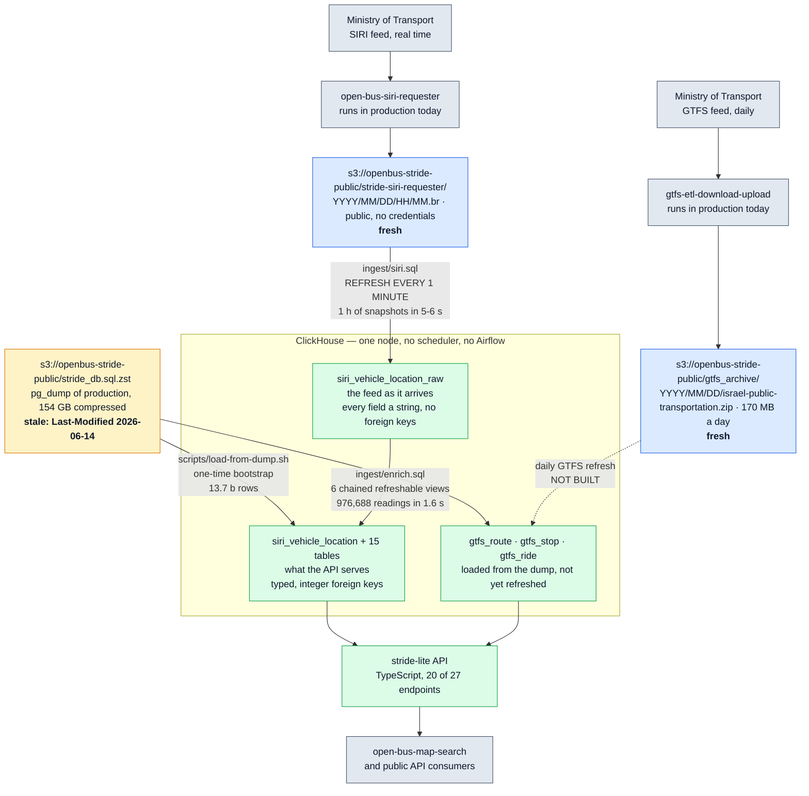

# stride-lite

[עברית](README.he.md) · **[Who decided what](#who-decided-what)** · **[What this found out about production](docs/FINDINGS.md)** · [Cost, performance, tradeoffs](docs/DEPLOYMENT.md) · [Roadmap](ROADMAP.md) · [Measurements](docs/BENCHMARKS.md) · [Run it locally](docs/LOCAL-DB.md)

A from-scratch reimplementation of the [Open Bus Stride](https://github.com/hasadna/open-bus-stride-api)
backend on ClickHouse. Same API contract, byte for byte; a fraction of the storage; no
Airflow.

This is an experiment, not a proposal to merge. It exists to answer one question with
numbers instead of opinions: **what would the Israeli public-transport data backend cost and
look like if it were built today?**

> 🤖 Most of the work in this repository was done by Claude (an AI agent) working with
> [@NoamGaash](https://github.com/NoamGaash). Every number below was measured in a session
> and is reproducible by the instructions in [docs/LOCAL-DB.md](docs/LOCAL-DB.md); nothing
> here is quoted from memory.

## Who decided what

This repository is one person's brief and an AI agent's execution of it. Those are not the
same thing, and a reader deciding whether to trust a number here needs to know which is
which. Three lists follow: what was asked for, what the agent chose on its own, and what it
actually did.

### What [@NoamGaash](https://github.com/NoamGaash) asked for

**The goal.** Rebuild the Open Bus Stride backend from scratch on ClickHouse, run it locally,
measure what it really costs in resources, price it on AWS, and — if it comes in under
**$150/month** — propose it as a replacement for the current Kamatera infrastructure.

**Definition of done.** An API serving data from a local database and returning the same
results as production.

**Three acceptance criteria**, stated as conditions and not aspirations:

1. **Every API endpoint preserves its behaviour**, proven by comparison against production.
2. **A simple implementation.** No complexity beyond what the problem requires.
3. **Modern infrastructure**: test coverage, infrastructure as code, CI/CD on GitHub Actions.

**Constraints added along the way**, each of which changed the work:

| Constraint | What it ruled out |
| --- | --- |
| Public-transport data must be **byte-for-byte identical**; our own internal ids may change | Settles the id question below — surrogate keys are ours to choose, MOT data is not |
| **Plug and play** — one command, not a mechanism to operate | Multi-step bring-up instructions as the final answer |
| **Do not load the machine.** It is a volunteer's workstation and their livelihood runs on it | Any default that assumes a dedicated server |
| **Do not over-simplify if it costs performance.** "Simple" is not a licence to be slow | Dropping indexes, projections or denormalisation to shorten the code |
| What the project pays today is **private**; estimates from public rates are fine | Any comparison quoting the real invoice |
| A **public repository**, no secrets, Hebrew and English documentation | — |
| **AI agents must identify themselves** when acting in the project (the repo's own rule) | — |

### What the agent interpreted, chose, or assumed

None of the following was requested. Each is a judgement call, and each could be wrong.

| Decision | Why | What would overturn it |
| --- | --- | --- |
| **ClickHouse**, single node | The workload is append-only analytics over one wide fact table | A write pattern needing real transactions |
| **"Same results" read as byte-identical JSON**, not matching status codes | A weaker reading makes criterion 1 untestable | — |
| **TypeScript** for the API | The generated client and the frontend are already TypeScript | — |
| **Refreshable materialized views as the scheduler** | `system.view_refreshes` already reports what Airflow is deployed to report | Work that genuinely needs a DAG, not a cadence |
| **No dbt, scheduler, queue, cache or ORM** | Criterion 2 — each would have to earn its place | A measurement showing one is needed |
| **Terraform**, as a module beside `hasadna-iac`'s existing ones | Continuation rather than a parallel toolchain | — |
| **The stale dump's window is the test boundary** | Every differential case must sit inside it or fail for a reason that is not a bug | Fresh data, which needs the unbuilt enrichment |
| **`m7g.large` + 300 GB gp3** for the estimate | Peak measured query memory was ≤25 MB, so 8 GB is not optimistic | A sustained measurement under continuous ingest, which has not been run |

### What the agent actually did

Measured, in a session, and reproducible by [docs/LOCAL-DB.md](docs/LOCAL-DB.md):

- Loaded the full 13,728,053,041-row public dump and measured storage per table and per engine.
- Wrote the API: **all 27 endpoints, verified byte-identical** across 48 differential tests.
- Built the continuous SIRI ingest from S3 — three SQL objects, no scheduler.
- Wrote the CI, the Terraform module, and 35 unit tests on SQL generation.
- Capped its own work on the machine: 6 of 24 cores, `nice 19`, and ClickHouse's own
  bandwidth and memory ceilings.

- Built the enrichment, so SIRI flows from S3 to the API with no scheduler.
- Read the upstream ETL rather than guessing at it, which is what settled the ride-identity
  and coordinate-dropping rules, and what turned up the findings in
  [docs/FINDINGS.md](docs/FINDINGS.md).

**Not done:**

- **The daily GTFS refresh is not built**, so the GTFS tables still age from the dump. This is
  the one piece of the pipeline that is still missing.
- **No sustained resource measurement.** The figures behind the AWS estimate are per-query and
  per-hour, not a 24-hour steady state under continuous ingest.
- **Nothing is deployed.** Stage 5 has not started.

## Quickstart

```bash
./up.sh
```

That is the whole thing. It fetches the ClickHouse binary, starts it under a memory ceiling,
I/O limits and six cores, creates the 16 tables, installs the ingest and enrichment chains,
backfills two hours of live SIRI from S3, and starts the API on :8080. From that moment the
database keeps itself current with no scheduler and no worker. `./up.sh 6` backfills six
hours instead; `./up.sh 0` backfills nothing and only moves forward.

No Docker, no root, no credentials — the data is public. The resource ceilings are in
[`ingest/local.xml`](ingest/local.xml) and exist because the reference machine for this
project is somebody's workstation; on a dedicated host, raise them. The full reproduction, including the
13.7-billion-row dump, is in [docs/LOCAL-DB.md](docs/LOCAL-DB.md); cost and cloud resources
are in [docs/DEPLOYMENT.md](docs/DEPLOYMENT.md).

## The three numbers that motivated this

Measured on the public 2026-06-14 production dump — all 16 tables, 13,728,053,041 rows,
loaded and counted, not extrapolated.

| | PostgreSQL today | ClickHouse |
| --- | --- | --- |
| `siri_vehicle_location` (6.5 billion rows) | **1.34 TB** | **111.52 GiB** |
| The entire database | ~692 GiB of data + ~760 GB of indexes | **163.22 GiB** |
| Growth per year | +307 GB | **+36 GB** |
| Estimated AWS bill | — | **~$96/month** |

Three findings behind them:

1. **Indexes are 55% of PostgreSQL's footprint** — 93 bytes of data against 107.6 bytes of
   index per row. A column store does not pay that.
2. **Nearly half the database is ETL output.** `siri_ride_stop` (2.80 billion) and
   `gtfs_ride_stop` (4.11 billion) exist only as precomputed results. In ClickHouse most of
   those relationships are `ALIAS` columns that cost zero bytes.
3. **The expensive part is the orchestration, not the data.** The recurring ETL work measures
   at about one second per hour, while the Airflow scheduler alone requests 20–25 GB of RAM
   and 2 cores. ClickHouse's `REFRESH EVERY` schedules the same work inside the database and
   reports it in `system.view_refreshes`.

## Where it stands

**27 of 27 endpoints, and 48 of 48 differential tests pass against production.** Not "same
status code" — the same JSON, ids included, because inside the comparison window both databases
hold the same rows under the same ids.

| | |
| --- | --- |
| Endpoints matching production | **27 of 27** |
| Differential tests | 48 passing, covering every endpoint in the published spec |
| Fields excluded from comparison | 2, both with a measured reason |
| Unit tests on SQL generation | 35, passing, no database required |
| Lines of API code | 1720 TypeScript |

A coverage test fails if the published spec ever grows an endpoint the suite does not exercise,
so "27 of 27" cannot quietly become 27 of 28.

**Three things that number does not claim**, stated here rather than in a footnote:

- **`/gtfs_rides_agg/list` has no production baseline.** Production answers it with a statement
  timeout — measured at 86 s and again at 103 s on a single day — so the case asserts only that
  this implementation answers. The data behind it is verified through
  `/gtfs_rides_agg/group_by`, which reads the same aggregate and does answer.
- **Two fields of `/siri_velocity_aggregation` are excluded.** Its rolling average uses a `ROWS`
  window over an `ORDER BY` with ties, so the frame depends on physical row order. Three
  identical calls to this implementation returned three different values, which means production
  cannot be stable either.
- **`/stop_arrivals/list` matches by both sides returning nothing.** That is the only contract it
  can still be held to, and why is in [FINDINGS.md](docs/FINDINGS.md).

The acceptance criterion is met. What remains is not the API —
[ROADMAP.md](ROADMAP.md) has it.

### What the contract turned out to be

Reimplementing an API is mostly discovering what it actually promises. Four things only the
source and live probes reveal, each of which silently breaks a client if you get it wrong:

- **Row ordering has four distinct shapes**, depending on how each handler declares the
  `order_by` parameter — not one default. `/gtfs_stops/list` ignores `order_by` entirely.
- **Two different datetime contracts.** A date-granular parameter takes a bare calendar day;
  an instant-granular one *requires* a timezone offset and converts to UTC rather than
  dropping it. Sending a bare date to the latter is a 422; omitting the offset is a 500.
- **Microsecond precision is per column**, not global. Getting this right rather than
  blanket-upgrading saved about 26 GB on the largest table.
- `/gtfs_rides/list` does not return within production's timeout for a plain date-range
  query, so that shape cannot serve as a differential baseline.

## Architecture



**Solid arrows are built and measured; dashed arrows are not built.** Three data sources, and
the difference between them matters:

- **The requester archives are live.** `stride-siri-requester/` gets a snapshot roughly every
  minute and `gtfs_archive/` a feed every day, both written by processes already running in
  production, both public and readable with `NOSIGN`. This is what the continuous ingest reads.
- **The database backup is not live.** It is a one-time bootstrap for four years of history,
  and it stopped being written on 2026-06-14.
- So the raw table tracks today while the API's tables stop at the dump — because the
  enrichment that would connect them is the missing arrow.

All three paths were checked against S3 on 2026-11-04: the dump still answers
`Last-Modified: Sun, 14 Jun 2026`, `gtfs_archive/2026/11/03/` holds that day's feed, and
`stride-siri-requester/2026/11/04/` was already on hour 05.

| Layer | Technology | New code |
| --- | --- | --- |
| SIRI collection | the existing `open-bus-siri-requester`, unchanged | none |
| SIRI ingest → raw table | ClickHouse `s3()` + refreshable materialized view | [`ingest/siri.sql`](ingest/siri.sql) — 3 objects, no scheduler |
| raw → the API's typed tables | 6 chained refreshable views, ordered by `DEPENDS ON` | [`ingest/enrich.sql`](ingest/enrich.sql) |
| GTFS daily refresh | shell: curl, unzip, `clickhouse-client` | **not built** |
| Scheduling | ClickHouse `REFRESH EVERY` | **none** |
| Monitoring | `system.view_refreshes` | **none** |
| API | TypeScript | the only service |
| Infrastructure | Terraform | — |

**The ingest loop is built and running**, which is the part the org's own `PLAN.md` still
lists as open ("keep track of ingested siri snapshots", "ingest new snapshots as they arrive",
*probably via Airflow*). It is three objects in one SQL file and no Airflow: a
`ReplacingMergeTree` of snapshot ids, an incremental view that maintains it from the data
itself, and two refreshable views that read S3 and skip what is already in. Measured against
the live archive: **one hour of snapshots ingests in 5–6 s, and re-running an already-loaded
hour writes 0 rows in 0 s.**

**The enrichment is built too**, so the pipeline is end to end: the API serves data that
reached S3 minutes earlier. The feed lands in `siri_vehicle_location_raw` as it arrives —
every field a string, no foreign keys — and six chained refreshable views derive the typed,
integer-keyed tables the API reads. `DEPENDS ON` is what orders them, so a ride is never
looked up before the route it hangs off exists.

Measured **on the full 13.7-billion-row database**, not on a scratch one: a cycle took 21 new
snapshots through all six steps by itself — 10 routes, 3 stops, 2,687 rides, 67,796 ride stops
and 167,980 vehicle locations, no exceptions — and the ids continue production's own sequences
rather than starting over. A cycle with nothing new costs about 1.4 s.

Because fresh data now flows, the differential test escapes the stale dump's window and can
run against production **for the same minute of today**. On one such minute:

| | |
| --- | --- |
| Rows returned, production vs ours | **5,765 vs 5,765** |
| Readings production has that we lack | **0** |
| Readings we have that production lacks | **0** |
| Identical on every transit-data field | **5,685 of 5,746 — 98.94%** |
| Differing | 61 rows, one vehicle, one field |

The 61 differ only in `siri_ride__scheduled_start_time`, all for one vehicle whose
`journey_ref` is the sentinel `…-0`. Production reports a departure time that **does not
appear anywhere in six hours of the feed**, so the cause is something the upstream ETL does
and is not yet understood. It is open, not explained away.

Two rules fell out of that comparison, and both were wrong in the first attempt:

- **A ride's identity is `(siri_route_id, journey_ref, vehicle_ref)` and not its
  `scheduled_start_time`** — those three are already unique over 123,622 rides in a day of
  the dump. Keying on the departure time splits one ride into several whenever the feed
  revises it: 65 rows in a single minute.
- **Production drops readings with no coordinates.** Zero NULL locations in 432,143
  production rows for an hour, against 407 empty ones in 335,227 raw rows. Keeping them
  returned four readings the production API does not.

### What only the full database revealed

The enrichment worked on a scratch database and was wrong on the real one, three times over,
and every fault was invisible until the tables were billions of rows rather than thousands:

| | Measured on the full database | After |
| --- | --- | --- |
| "Which of these rides already exist" built a set of all 110M rides | **6.83 GiB, over the ceiling** | 0.079 s, bounded by `journey_ref` |
| Joining `siri_ride_stop` unrestricted | **2.89 billion rows read, 545 s, unfinished** | 3.8 s, bounded to the batch |
| `max(id)` on `siri_vehicle_location` | **149 s a refresh, even with nothing to insert** | 0.130 s, from a high-water table |

The second is the same fault as the API's heavy join, and the first and third are both about
sort order: restricting by `siri_route_id` prunes nothing because an hour's 3,914 routes own
91,961,186 historical rides, while its 19,668 `journey_ref`s own none; and `max(id)` is a full
scan precisely on the one table that is sorted by `(recorded_at_time, id)` rather than by `id`.

A fourth was a correctness fault rather than a performance one. Deduplicating on
`(siri_snapshot_id, siri_ride_stop_id, recorded_at_time)` looked safe and is not a key:
production holds **785 genuine duplicates on that triple in one measured hour**, so the filter
would have silently dropped rows production keeps. Idempotency is per snapshot now, which is
the granularity upstream processes at and the same one the ingest already used.

`system.view_refreshes` reports `status`, `next_refresh_time`,
`written_rows` and `exception` — the visibility Airflow is there to provide, inside the
database.

**TypeScript for the API on purpose**, not by taste: the generated client
`@hasadna/open-bus-api-client` and the [frontend](https://github.com/hasadna/open-bus-map-search)
are already TypeScript, so types are shared end to end.

**Deliberately absent:** dbt, a scheduler, a message queue, a cache layer, an ORM. 27 GET
endpoints with filters and sorting are query construction, not an object model. Each omission
is argued in [ROADMAP.md](ROADMAP.md).

## Layout

```
up.sh             one command: binary, server, schema, ingest, enrichment, API
db/schema.sql     the 16 tables, dumped from the running instance
ingest/           siri.sql (ingest), enrich.sql (6-step chain), backfill.sh, local.xml
api/              TypeScript service — src/{sql,registry,server,ch}.ts
infra/main.tf     Terraform module
scripts/          apply-schema.sh, load-from-dump.sh
docs/             BENCHMARKS.md (the full measured report), LOCAL-DB.md
```

If this goes anywhere, the pieces split back into the org's repos — `db/` and ingest into
`open-bus-stride-clickhouse`, `api/` into `open-bus-stride-api`, `infra/` into `hasadna-iac`.
The directory boundaries are kept clean from day one so that split is mechanical.

## Honest caveats

- **The GTFS tables are still frozen at the dump.** SIRI flows end to end; the daily GTFS
  refresh from `gtfs_archive/` is not built, so routes and stops age.
- **61 rows in a measured minute still differ** from production in
  `siri_ride__scheduled_start_time`, for one vehicle with a sentinel journey ref, and the
  cause is not understood.
- The public dump is **4.6 months old** — `Last-Modified: 2026-06-14`, data ending
  2026-05-29. Every differential test case has to stay inside that window, which is the
  single biggest constraint on this work.
- **PostgreSQL wins one query** — a selective `line_ref` + bounding-box filter, 0.017 s
  against 0.063–0.090 s. B-tree indexes on `lon`/`lat` are the right tool there, and closing
  the gap with skip indexes is work not yet done.
- The AWS estimate's one unquantified risk is **egress above CloudFront's free 1 TB**,
  which needs a real traffic figure before anyone relies on the ~$96. The estimate itself is
  built from published AWS rates; what the project pays today was reported privately and is
  not in this repository.
- **Projections are measured now, not predicted, and they cost more than was assumed.**
  Three of them take the total from 163.22 GiB to **231.82 GiB**: `gtfs_ride_stop.by_ride`
  29.88 GiB, and two on `siri_ride_stop` — `by_gtfs_stop` 19.31 GiB and `by_siri_ride`
  18.94 GiB — because that table is filtered by two different foreign keys and sorted by
  neither. Quote 232 GiB, not 163.
- This repository does not answer the questions that actually decide a migration: who
  maintains it, what happens at 3 a.m., and what breaks in a provider move. Those are the
  maintainers' calls, and measurements do not settle them.

## Licence

MIT. The data is public, published by the Israeli Ministry of Transport and collected by the
[Public Knowledge Workshop](https://www.hasadna.org.il/).
