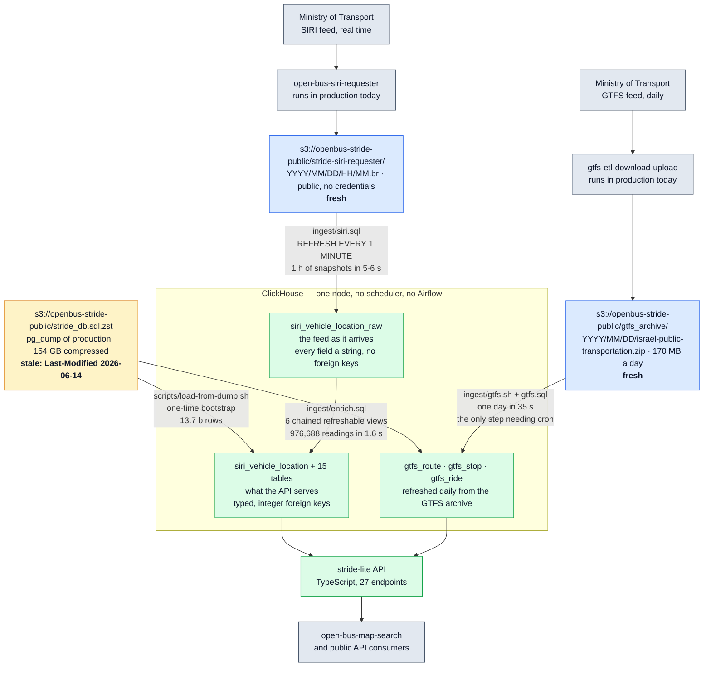

# איך זה עובד

[English](DESIGN.md)

התכנון שמאחורי [ה-README](../README.he.md): מה נמדד, מה ה-API הישן הבטיח בפועל, ומה רק המסד המלא חשף.

## שלושת המספרים שהניעו את זה

נמדד על גיבוי הפרודקשן הציבורי מ-14/06/2026 — כל 16 הטבלאות, 13,728,053,041 שורות,
טעונות ונספרות בפועל, לא באקסטרפולציה.

| | PostgreSQL היום | ClickHouse |
| --- | --- | --- |
| `siri_vehicle_location` (6.5 מיליארד שורות) | **1.34 TB** | **111.52 GiB** |
| כל מסד הנתונים | כ-692 GiB נתונים גולמיים ועוד כ-760 GB אינדקסים | **163.98 GiB**, או 233.02 GiB עם כל ה-projections |
| גדילה בשנה | +307 GB | **+36 GB** |
| חשבון AWS משוער | — | **$2.10 ליום, $63.88 לחודש** |

שלושה ממצאים שמסבירים אותם:

1. **האינדקסים הם 55% מהנפח של PostgreSQL** — 93 בתים של נתונים מול 107.6 בתים של אינדקס
   לשורה. מסד עמודות לא משלם את זה.
2. **כמעט חצי מהמסד הוא פלט ETL.**

   `siri_ride_stop` (2.80 מיליארד) ו-`gtfs_ride_stop` (4.11 מיליארד) קיימות רק כתוצאות
   שחושבו מראש. ב-ClickHouse רוב הקשרים האלה הם עמודות `ALIAS` בעלות אחסון אפס.
3. **היוקר הוא בתזמור, לא בדאטא.**

   העבודה השוטפת של ה-ETL נמדדת בשנייה אחת לשעה, בעוד ה-scheduler של Airflow לבדו מבקש
   20-25 GB RAM ושתי ליבות. ה-`REFRESH EVERY` של ClickHouse מתזמן את אותה עבודה בתוך המסד
   ומדווח עליה ב-`system.view_refreshes`.

## מה החוזה באמת אומר

מימוש מחדש של API הוא בעיקר גילוי מה הוא למעשה מבטיח.

ארבעה דברים שרק הקוד והבדיקות החיות חושפים, וכל אחד מהם שובר לקוח בשקט אם טועים בו:

- **לסדר השורות יש ארבע צורות שונות**, לפי האופן שבו כל handler מכריז על הפרמטר `order_by`
  — לא ברירת מחדל אחת. `/gtfs_stops/list` מתעלם מ-`order_by` לגמרי.
- **שני חוזי datetime נפרדים.**

  פרמטר ברזולוציית יום מקבל תאריך קלנדרי חשוף. פרמטר ברזולוציית רגע **דורש** היסט אזור זמן
  וממיר ל-UTC במקום להשמיט אותו. שליחת תאריך חשוף לשני היא 422; השמטת ההיסט היא 500.
- **דיוק המיקרו-שניות הוא פר עמודה**, לא גלובלי. דיוק בזה, במקום שדרוג גורף, חסך כ-26 GB
  בטבלה הגדולה ביותר.
- `/gtfs_rides/list` לא חוזר בתוך ה-timeout של הפרודקשן על שאילתת טווח תאריכים פשוטה, ולכן
  הצורה הזאת לא יכולה לשמש בסיס להשוואה דיפרנציאלית.

## ארכיטקטורה

**כל חץ בתרשים בנוי ונמדד.** תוויות התרשים באנגלית בכוונה — שמות טבלאות ונתיבי S3 הם ממילא
לטינית, ועירוב כיווניות בתוך SVG נשבר.

שלושה מקורות דאטא, וההבדל ביניהם הוא מה שחשוב:

- **הארכיונים של ה-requesters חיים.** ל-`stride-siri-requester/` נכנס snapshot בקירוב כל דקה
  ול-`gtfs_archive/` פיד כל יום, שניהם נכתבים על ידי תהליכים שכבר רצים בפרודקשן, ושניהם
  ציבוריים וניתנים לקריאה עם `NOSIGN`. זה מה שלופ ה-ingest הרציף קורא.
- **הגיבוי של מסד הנתונים אינו חי.** הוא bootstrap חד-פעמי לארבע שנות היסטוריה, והוא הפסיק
  להיכתב ב-14/06/2026.

| שכבה | טכנולוגיה | קוד חדש |
| --- | --- | --- |
| איסוף SIRI | ה-`open-bus-siri-requester` הקיים, ללא שינוי | אין |
| ingest של SIRI → טבלה גולמית | ClickHouse `s3()` ועוד materialized view מתרענן | [`ingest/siri.sql`](../ingest/siri.sql) — 3 אובייקטים, בלי scheduler |
| מהגולמי לטבלאות המוקלדות של ה-API | 6 views מתרעננים בשרשרת, מסודרים ב-`DEPENDS ON` | [`ingest/enrich.sql`](../ingest/enrich.sql) |
| רענון יומי של GTFS | shell: curl, unzip, `clickhouse-client`, ואז SQL | [`ingest/gtfs.sh`](../ingest/gtfs.sh) ועוד [`ingest/gtfs.sql`](../ingest/gtfs.sql) |
| תזמון | `REFRESH EVERY` של ClickHouse | **אין** |
| ניטור | `system.view_refreshes` | **אין** |
| API | TypeScript | השירות היחיד |
| אריזה | image אחד של Docker ל-API, ל-schema ול-jobs | [`Dockerfile`](../Dockerfile) |
| תשתית | Terraform | — |

**לופ ה-ingest בנוי ורץ** — וזה בדיוק החלק שה-`PLAN.md` של הסדנה עצמה עוד מסמן כפתוח
("לעקוב אחרי snapshots שנטענו", "לטעון snapshots חדשים כשהם מגיעים", *probably via Airflow*).

זה שלושה אובייקטים בקובץ SQL אחד ובלי Airflow: טבלת `ReplacingMergeTree` של מזהי snapshots,
view אינקרמנטלי שמתחזק אותה מהנתונים עצמם, ושני views מתרעננים שקוראים מ-S3 ומדלגים על מה
שכבר בפנים.

נמדד מול הארכיון החי: **שעה של snapshots נטענת ב-5-6 שניות, והרצה חוזרת על שעה שכבר נטענה
כותבת 0 שורות ב-0 שניות.**

**גם ה-enrichment בנוי**, ולכן הצינור שלם מקצה לקצה: ה-API משרת נתונים שהגיעו ל-S3 דקות
קודם לכן.

הפיד נוחת ב-`siri_vehicle_location_raw` כפי שהוא מגיע — כל שדה string, בלי מפתחות זרים —
ושישה views מתרעננים בשרשרת גוזרים ממנו את הטבלאות המוקלדות שה-API קורא. `DEPENDS ON` הוא
מה שמסדר אותם, כך שנסיעה לעולם לא מחפשת מסלול שעוד לא קיים.

נמדד **על המסד המלא בן 13.7 מיליארד השורות**, לא על מסד בדיקה: מחזור אחד העביר 21 snapshots
חדשים בכל ששת הצעדים לבדו — 10 מסלולים, 3 תחנות, 2,687 נסיעות, 67,796 עצירות ו-167,980
מיקומים, בלי חריגות — וה-ids ממשיכים את הרצפים של הפרודקשן עצמו ולא מתחילים מחדש. מחזור בלי
נתונים חדשים עולה כ-1.4 שניות.

ומכיוון שנתונים טריים זורמים עכשיו, ההשוואה הדיפרנציאלית נחלצת מחלון הדאמפ התקוע ויכולה לרוץ
מול הפרודקשן **על אותה דקה של היום**. על דקה כזאת:

| | |
| --- | --- |
| שורות שהוחזרו, פרודקשן מול שלנו | **5,765 מול 5,765** |
| קריאות שיש לפרודקשן וחסרות לנו | **0** |
| קריאות שיש לנו ואין לפרודקשן | **0** |
| זהות בכל שדה של מידע תחב"צ | **5,685 מתוך 5,746 — 98.94%** |
| נבדלות | 61 שורות, רכב אחד, שדה אחד |

ה-61 נבדלות רק ב-`siri_ride__scheduled_start_time`, כולן ברכב אחד שה-`journey_ref` שלו הוא
הסנטינל `…-0`. הפרודקשן מדווח זמן יציאה ש**אינו מופיע בשום מקום בשש שעות של הפיד**, ולכן
הסיבה היא משהו שה-ETL במעלה הזרם עושה ושעדיין לא מובן. זה פתוח, ולא מוסבר בדיעבד.

שני כללים נגזרו מההשוואה הזאת, ושניהם היו שגויים בניסיון הראשון:

- **זהות הנסיעה היא `(siri_route_id, journey_ref, vehicle_ref)` ולא ה-`scheduled_start_time`
  שלה** — שלושת אלה כבר ייחודיים על פני 123,622 נסיעות ביום אחד מהדאמפ. מפתוח לפי זמן
  היציאה מפצל נסיעה אחת לכמה בכל פעם שהפיד מתקן אותו: 65 שורות בדקה אחת.
- **הפרודקשן מסנן קריאות בלי קואורדינטות.** אפס מיקומים ריקים ב-432,143 שורות פרודקשן בשעה,
  מול 407 ריקים ב-335,227 שורות גולמיות. שמירה שלהן החזירה ארבע קריאות שה-API של הפרודקשן
  לא מחזיר.

## מה שרק המסד המלא חשף

ה-enrichment עבד על מסד בדיקה והיה שגוי על האמיתי, שלוש פעמים, וכל תקלה הייתה בלתי נראית עד
שהטבלאות היו מיליארדי שורות ולא אלפים:

| | נמדד על המסד המלא | אחרי |
| --- | --- | --- |
| "אילו מהנסיעות האלה כבר קיימות" בנה set של כל 110 מיליון | **6.83 GiB, מעל התקרה** | 0.079 שניות, מצומצם לפי `journey_ref` |
| Join ל-`siri_ride_stop` בלי צמצום | **2.89 מיליארד שורות נקראו, 545 שניות, לא הסתיים** | 3.8 שניות, מצומצם לאצווה |
| `max(id)` על `siri_vehicle_location` | **149 שניות לכל רענון, גם כשאין מה להכניס** | 0.130 שניות, מטבלת high-water |

השנייה היא אותה תקלה כמו ה-join הכבד של ה-API, והראשונה והשלישית שתיהן על סדר מיון: צמצום לפי
`siri_route_id` לא מצמצם כלום כי 3,914 המסלולים של שעה מחזיקים 91,961,186 נסיעות היסטוריות,
בעוד 19,668 ה-`journey_ref` שלה מחזיקים אפס; ו-`max(id)` הוא סריקה מלאה בדיוק על הטבלה היחידה
שממוינת לפי `(recorded_at_time, id)` ולא לפי `id`.

רביעית הייתה תקלת נכונות ולא ביצועים. סינון כפילויות לפי
`(siri_snapshot_id, siri_ride_stop_id, recorded_at_time)` נראה בטוח ואינו מפתח: בפרודקשן יש
**785 כפילויות לגיטימיות על השלשה הזאת בשעה אחת שנמדדה**, ולכן הסינון היה זורק בשקט שורות
שהפרודקשן שומר. האידמפוטנטיות היא לפי snapshot עכשיו, שזו הרזולוציה שבה המקור מעבד וזו שה-ingest
כבר השתמש בה.

`system.view_refreshes` מדווח `status`, `next_refresh_time`, `written_rows` ו-`exception` —
בדיוק הנראות שבגללה יש Airflow, בתוך מסד הנתונים.

## GTFS, החצי השני של הפיד

[`ingest/gtfs.sh`](../ingest/gtfs.sh) טוען יום מארכיון ה-GTFS הציבורי, ו-[`ingest/gtfs.sql`](../ingest/gtfs.sql)
גוזר ממנו את `gtfs_route`, `gtfs_stop`, `gtfs_stop_mot_id`, `gtfs_ride` ו-`gtfs_ride_stop`.
**יום אחד לוקח 35 שניות**, מול 1,580 שורות הפייתון שעושות את זה במקור.

**זה הדבר היחיד שצריך scheduler**, ולהעמיד פנים אחרת יהיה לא כנה: ClickHouse קורא מ-S3 ישירות
אבל אינו יודע לקרוא zip מרובה-קבצים, אז את הפיד צריך להוריד ולפרוס ב-shell. שורה אחת ב-cron,
ו-`up.sh` עושה את הטעינה הראשונה.

אומת מול הפרודקשן על 20/05/2026, תאריך ששני המסדים מחזיקים:

| | |
| --- | --- |
| מסלולים | **6,423 מול 6,423**, וכל שדה זהה |
| תחנות | **30,417 מול 30,417** |
| נסיעות משותפות | 7,423, ו-`start_time`, `end_time` והמסלול כולם זהים |
| עצירות משותפות | **242,921, וכל שדה זהה** |

כדי להגיע לשם היה צריך לשחזר שלוש התנהגויות במקור שהן באגים ולא תכנון, ושמימוש מחדש "מתקן"
אותן בשקט ולכן טועה:

- **`route_short_name` ריק נשמר כמחרוזת `"NaN"`.** הוא מגיע למסד דרך pandas כ-float NaN ונכתב
  כ-`str()` שלו. 596 מתוך 6,423 מסלולים.
- **תחנה מקבלת שורה לכל `stop_id`, לא לכל `stop_code`.** הטוען ממפתח את המטמון שלו לפי code
  אבל לעולם לא מכניס אליו תחנה חדשה, אז code חוזר מוסיף שורה שוב. זה בדיוק הפער של 551 שורות
  בין 30,417 מזהי תחנה פעילים ל-29,866 קודים.
- **`shape_dist_traveled` של 0 הופך ל-NULL**, כי המקור בודק `if not value` ו-`not 0.0` הוא אמת
  בפייתון. 6,827 מתוך 242,921 שורות.

כל אחת מהן משוחזרת ולא מתוקנת. מיגרציה שמשנה בשקט את מה שה-API מחזיר אינה מיגרציה, והן רשומות
ב-[FINDINGS.he.md](FINDINGS.he.md) כדי שיתוקנו בכוונה.

**דבר אחד שאי אפשר לשחזר**, והסיבה היא של המקור ולא שלנו: התוכן של הפרודקשן לתאריך עבר אינו
פונקציה של אף פיד יחיד. הנסיעות שלו ל-20/05/2026 הן תערובת של שתי גרסאות פיד — 115,060 נסיעות
עם הסיומת של הפיד מ-19/05 ו-6,838 עם זו של 20/05 — כי הטוען עושה upsert ולעולם לא מוחק, אז כל
הרצה חוזרת משאירה שכבה. טעינה של כל יום מהפיד שלו, כפי שנעשה כאן, נותנת תשובה אחת עקבית.

**TypeScript ב-API בכוונה**, לא לפי טעם: ה-client הנוצר
`@hasadna/open-bus-api-client` וה-[פרונטאנד](https://github.com/hasadna/open-bus-map-search)
כבר כתובים ב-TypeScript, כך שהטיפוסים משותפים מקצה לקצה.

**מה שחסר בכוונה:** dbt, scheduler, תור הודעות, שכבת cache, ORM.

27 endpoints של GET עם סינון וסידור הם בניית שאילתות, לא מודל אובייקטים. כל השמטה מנומקת
ב-[ROADMAP.he.md](../ROADMAP.he.md).
