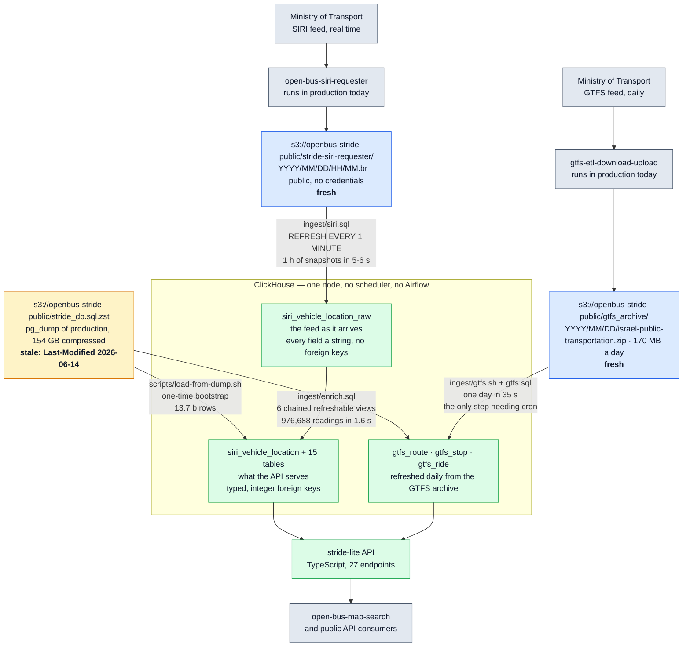

# How it works

[עברית](DESIGN.he.md)

The design behind [the README](../README.md): what was measured, what the old API turned out to promise, and what only the full database revealed.

## The three numbers that motivated this

Measured on the public 2026-06-14 production dump — all 16 tables, 13,728,053,041 rows,
loaded and counted, not extrapolated.

| | PostgreSQL today | ClickHouse |
| --- | --- | --- |
| `siri_vehicle_location` (6.5 billion rows) | **1.34 TB** | **111.52 GiB** |
| The entire database | ~692 GiB of data + ~760 GB of indexes | **163.98 GiB**, or 233.02 GiB with every projection |
| Growth per year | +307 GB | **+36 GB** |
| Estimated AWS bill | — | **$2.10/day, $63.88/month** |

Three findings behind them:

1. **Indexes are 55% of PostgreSQL's footprint** — 93 bytes of data against 107.6 bytes of
   index per row. A column store does not pay that.
2. **Nearly half the database is ETL output.** `siri_ride_stop` (2.80 billion) and
   `gtfs_ride_stop` (4.11 billion) exist only as precomputed results. In ClickHouse most of
   those relationships are `ALIAS` columns that cost zero bytes.
3. **The expensive part is the orchestration, not the data.** The recurring ETL work measures
   at about one second per hour, while the Airflow scheduler alone requests 20–25 GB of RAM
   and 2 cores. ClickHouse's `REFRESH EVERY` schedules the same work inside the database and
   reports it in `system.view_refreshes`.

## What the contract turned out to be

Reimplementing an API is mostly discovering what it actually promises. Four things only the
source and live probes reveal, each of which silently breaks a client if you get it wrong:

- **Row ordering has four distinct shapes**, depending on how each handler declares the
  `order_by` parameter — not one default. `/gtfs_stops/list` ignores `order_by` entirely.
- **Two different datetime contracts.** A date-granular parameter takes a bare calendar day;
  an instant-granular one *requires* a timezone offset and converts to UTC rather than
  dropping it. Sending a bare date to the latter is a 422; omitting the offset is a 500.
- **Microsecond precision is per column**, not global. Getting this right rather than
  blanket-upgrading saved about 26 GB on the largest table.
- `/gtfs_rides/list` does not return within production's timeout for a plain date-range
  query, so that shape cannot serve as a differential baseline.

## Architecture

**Every arrow is built and measured.** Three data sources, and the difference between them
matters:

- **The requester archives are live.** `stride-siri-requester/` gets a snapshot roughly every
  minute and `gtfs_archive/` a feed every day, both written by processes already running in
  production, both public and readable with `NOSIGN`. This is what the continuous ingest reads.
- **The database backup is not live.** It is a one-time bootstrap for four years of history,
  and it stopped being written on 2026-06-14.

| Layer | Technology | New code |
| --- | --- | --- |
| SIRI collection | the existing `open-bus-siri-requester`, unchanged | none |
| SIRI ingest → raw table | ClickHouse `s3()` + refreshable materialized view | [`ingest/siri.sql`](../ingest/siri.sql) — 3 objects, no scheduler |
| raw → the API's typed tables | 6 chained refreshable views, ordered by `DEPENDS ON` | [`ingest/enrich.sql`](../ingest/enrich.sql) |
| GTFS daily refresh | shell: curl, unzip, `clickhouse-client`, then SQL | [`ingest/gtfs.sh`](../ingest/gtfs.sh) + [`ingest/gtfs.sql`](../ingest/gtfs.sql) |
| Scheduling | ClickHouse `REFRESH EVERY` | **none** |
| Monitoring | `system.view_refreshes` | **none** |
| API | TypeScript | the only service |
| Packaging | one Docker image for the API, the schema and the jobs | [`Dockerfile`](../Dockerfile) |
| Infrastructure | Terraform | — |

**The ingest loop is built and running**, which is the part the org's own `PLAN.md` still
lists as open ("keep track of ingested siri snapshots", "ingest new snapshots as they arrive",
*probably via Airflow*). It is three objects in one SQL file and no Airflow: a
`ReplacingMergeTree` of snapshot ids, an incremental view that maintains it from the data
itself, and two refreshable views that read S3 and skip what is already in. Measured against
the live archive: **one hour of snapshots ingests in 5–6 s, and re-running an already-loaded
hour writes 0 rows in 0 s.**

**The enrichment is built too**, so the pipeline is end to end: the API serves data that
reached S3 minutes earlier. The feed lands in `siri_vehicle_location_raw` as it arrives —
every field a string, no foreign keys — and six chained refreshable views derive the typed,
integer-keyed tables the API reads. `DEPENDS ON` is what orders them, so a ride is never
looked up before the route it hangs off exists.

Measured **on the full 13.7-billion-row database**, not on a scratch one: a cycle took 21 new
snapshots through all six steps by itself — 10 routes, 3 stops, 2,687 rides, 67,796 ride stops
and 167,980 vehicle locations, no exceptions — and the ids continue production's own sequences
rather than starting over. A cycle with nothing new costs about 1.4 s.

Because fresh data now flows, the differential test escapes the stale dump's window and can
run against production **for the same minute of today**. On one such minute:

| | |
| --- | --- |
| Rows returned, production vs ours | **5,765 vs 5,765** |
| Readings production has that we lack | **0** |
| Readings we have that production lacks | **0** |
| Identical on every transit-data field | **5,685 of 5,746 — 98.94%** |
| Differing | 61 rows, one vehicle, one field |

The 61 differ only in `siri_ride__scheduled_start_time`, all for one vehicle whose
`journey_ref` is the sentinel `…-0`. Production reports a departure time that **does not
appear anywhere in six hours of the feed**, so the cause is something the upstream ETL does
and is not yet understood. It is open, not explained away.

Two rules fell out of that comparison, and both were wrong in the first attempt:

- **A ride's identity is `(siri_route_id, journey_ref, vehicle_ref)` and not its
  `scheduled_start_time`** — those three are already unique over 123,622 rides in a day of
  the dump. Keying on the departure time splits one ride into several whenever the feed
  revises it: 65 rows in a single minute.
- **Production drops readings with no coordinates.** Zero NULL locations in 432,143
  production rows for an hour, against 407 empty ones in 335,227 raw rows. Keeping them
  returned four readings the production API does not.

## What only the full database revealed

The enrichment worked on a scratch database and was wrong on the real one, three times over,
and every fault was invisible until the tables were billions of rows rather than thousands:

| | Measured on the full database | After |
| --- | --- | --- |
| "Which of these rides already exist" built a set of all 110M rides | **6.83 GiB, over the ceiling** | 0.079 s, bounded by `journey_ref` |
| Joining `siri_ride_stop` unrestricted | **2.89 billion rows read, 545 s, unfinished** | 3.8 s, bounded to the batch |
| `max(id)` on `siri_vehicle_location` | **149 s a refresh, even with nothing to insert** | 0.130 s, from a high-water table |

The second is the same fault as the API's heavy join, and the first and third are both about
sort order: restricting by `siri_route_id` prunes nothing because an hour's 3,914 routes own
91,961,186 historical rides, while its 19,668 `journey_ref`s own none; and `max(id)` is a full
scan precisely on the one table that is sorted by `(recorded_at_time, id)` rather than by `id`.

A fourth was a correctness fault rather than a performance one. Deduplicating on
`(siri_snapshot_id, siri_ride_stop_id, recorded_at_time)` looked safe and is not a key:
production holds **785 genuine duplicates on that triple in one measured hour**, so the filter
would have silently dropped rows production keeps. Idempotency is per snapshot now, which is
the granularity upstream processes at and the same one the ingest already used.

`system.view_refreshes` reports `status`, `next_refresh_time`,
`written_rows` and `exception` — the visibility Airflow is there to provide, inside the
database.

## GTFS, the other half of the feed

[`ingest/gtfs.sh`](../ingest/gtfs.sh) loads a day of the published GTFS archive and
[`ingest/gtfs.sql`](../ingest/gtfs.sql) derives `gtfs_route`, `gtfs_stop`, `gtfs_stop_mot_id`,
`gtfs_ride` and `gtfs_ride_stop` from it. **One day takes 35 seconds**, against the 1,580 lines
of Python that do it upstream.

**It is the one thing that needs a scheduler**, and pretending otherwise would be dishonest:
ClickHouse reads S3 directly but cannot read a multi-file zip, so the feed has to be fetched
and unpacked by a shell. One line of cron, and `up.sh` does the first load.

Verified against production on 2026-05-20, which both databases hold:

| | |
| --- | --- |
| Routes | **6,423 vs 6,423**, and every field identical |
| Stops | **30,417 vs 30,417** |
| Rides present in both | 7,423, and `start_time`, `end_time` and route all identical |
| Ride stops present in both | **242,921, and every field identical** |

Getting there meant reproducing three upstream behaviours that are bugs, not design, and that
a reimplementation silently gets "right" and therefore wrong:

- **An empty `route_short_name` is stored as the literal string `"NaN"`.** It reaches the
  database through pandas as a float NaN and is written as its `str()`. 596 of 6,423 routes.
- **A stop gets one row per `stop_id`, not per `stop_code`.** The loader keys its cache by
  code but never puts a newly-created stop into that cache, so a repeated code inserts again.
  That is exactly the 551-row gap between 30,417 active stop_ids and 29,866 codes.
- **A `shape_dist_traveled` of 0 becomes NULL**, because upstream guards with
  `if not value` and `not 0.0` is true in Python. 6,827 of 242,921 rows.

Each is reproduced rather than corrected. A migration that quietly changes what the API
returns is not a migration, and these belong in [FINDINGS.md](FINDINGS.md) to be fixed
deliberately instead.

**One thing it cannot reproduce**, and the reason is upstream's and not ours: production's
content for a past date is not a function of any single feed. Its rides for 2026-05-20 are a
mix of two feed versions — 115,060 trips carrying the 19/05 feed's suffix and 6,838 carrying
the 20/05 one — because the loader upserts and never deletes, so each re-run leaves its layer
behind. Loading each day from its own feed, as this does, gives one consistent answer instead.

**TypeScript for the API on purpose**, not by taste: the generated client
`@hasadna/open-bus-api-client` and the [frontend](https://github.com/hasadna/open-bus-map-search)
are already TypeScript, so types are shared end to end.

**Deliberately absent:** dbt, a scheduler, a message queue, a cache layer, an ORM. 27 GET
endpoints with filters and sorting are query construction, not an object model. Each omission
is argued in [ROADMAP.md](../ROADMAP.md).
